# Benchmarking Quantum Optimization for Microgrid Energy Dispatch

[](#citation)
[](https://colab.research.google.com/github/JannatulShorna12/Benchmarking-Quantum-Optimization-for-Microgrid-Energy-Dispatch/blob/main/notebooks/reproduce_paper.ipynb)
[](https://github.com/JannatulShorna12/Benchmarking-Quantum-Optimization-for-Microgrid-Energy-Dispatch/actions/workflows/reproduce.yml)
[](requirements.txt)
[](LICENSE)

Jannatul Ferdous Shorna, Zhen Ni, Zebo Yang, Yufei Tang (Florida Atlantic University) and
Avijit Das (Pacific Northwest National Laboratory)

Code, data and results for our paper at the 2026 North American Power Symposium (NAPS 2026):
gate-based QAOA on IBM Kingston, quantum annealing on D-Wave Advantage2 and the D-Wave Stride
hybrid solver, benchmarked against MILP for rolling microgrid dispatch on real ERCOT data.

**[Poster](poster/NAPS2026_poster.pdf)** | **[Results](#results)** |
**[Run in Colab](https://colab.research.google.com/github/JannatulShorna12/Benchmarking-Quantum-Optimization-for-Microgrid-Energy-Dispatch/blob/main/notebooks/reproduce_paper.ipynb)** |
**[QUBO instances](#qubo-benchmark-instances)** | **[Dataset](data/README.md)** | **[Citation](#citation)**

## Highlights

- Two quantum hardware platforms, IBM Kingston (QAOA, p = 2 and 3) and D-Wave Advantage2 (quantum
  annealing), dispatch a battery microgrid over 6 days and 144 rolling windows on ARPA-E PERFORM
  ERCOT data. Both return feasible schedules in every window.
- Gap to the MILP: 13.8% for IBM QAOA, 17.9% for D-Wave Advantage2 and 3.8% for the D-Wave Stride
  hybrid solver.
- Exhaustive enumeration of all 2^20 assignments per window shows that 13.73% of the gap comes from
  the 3-bit grid-import encoding alone. IBM QAOA is within 0.05% of the exact QUBO optimum, and
  classical samplers on the same QUBO are 3.1% to 3.7% above it.
- 144 QUBO benchmark instances with reference solutions are included, ready for other solvers.
- Every table and figure of the paper is rebuilt from the stored runs in a few seconds, with no
  quantum account.

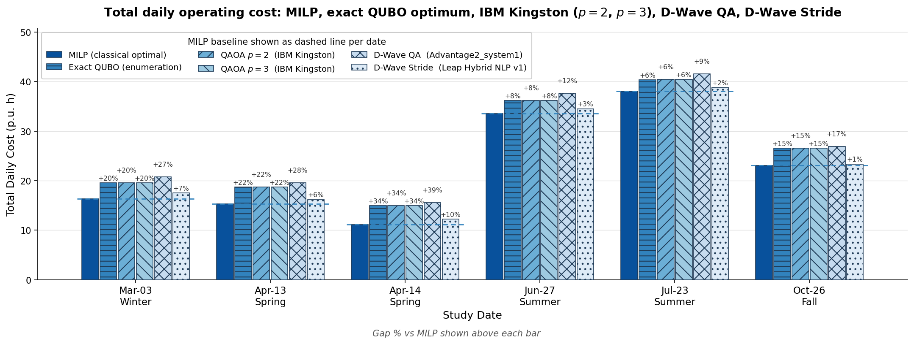

## Quick start

```
git clone https://github.com/JannatulShorna12/Benchmarking-Quantum-Optimization-for-Microgrid-Energy-Dispatch.git
cd Benchmarking-Quantum-Optimization-for-Microgrid-Energy-Dispatch
pip install -r requirements.txt
python scripts/reproduce_paper.py
```

Or open the [Colab notebook](https://colab.research.google.com/github/JannatulShorna12/Benchmarking-Quantum-Optimization-for-Microgrid-Energy-Dispatch/blob/main/notebooks/reproduce_paper.ipynb),
which needs no installation.

## Abstract

Microgrid energy dispatch is becoming increasingly challenging as rising renewable penetration
introduces uncertainty into operational planning and control. Classical optimization, stochastic
programming, and heuristic methods have been widely studied for this problem. Microgrid energy
dispatch becomes a large combinatorial optimization problem, motivating interest in quantum
optimization for exploring large binary decision spaces. This paper presents a quantum optimization
framework in which each dispatch window is reformulated as a quadratic unconstrained binary
optimization (QUBO) problem with binary-encoded grid-import and battery-dispatch decisions and
operational constraints incorporated through penalty terms. Performance is evaluated against a
mixed-integer linear programming (MILP) baseline. Across six operating days, both quantum hardware
platforms yield feasible schedules at 13.8% (IBM QAOA) and 17.9% (D-Wave Advantage2) above the MILP
baseline; a classical-quantum hybrid nonlinear reference (D-Wave Stride) reaches 3.8%. Exhaustive
enumeration attributes 13.73% to the binary encoding alone, placing IBM QAOA within 0.05% of the
exact QUBO optimum.

## Poster

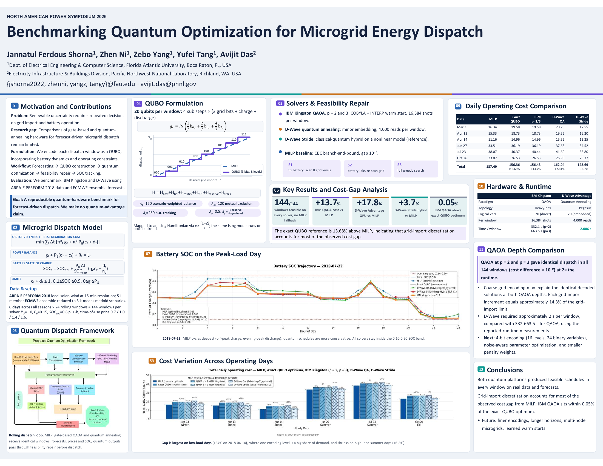

## Framework

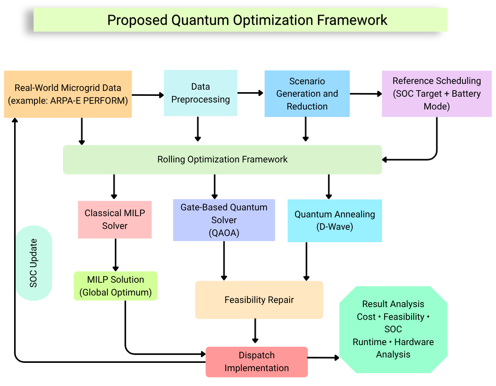

Real operating data are preprocessed and reduced to representative scenarios. A day-ahead MILP gives
the SOC reference and battery mode for the rolling scheduler. Each hour is one dispatch window of four
15-minute steps, solved by the MILP, by QAOA on IBM Kingston and by quantum annealing on D-Wave.
Quantum outputs pass through feasibility repair before dispatch, and every solver carries its own SOC
from one window to the next.

## Method and settings

### Microgrid model (Section II)

```
objective      min  sum_t  dt [ pi_t^g g_t + pi^b P_B (c_t + d_t) ]
power balance  g_t + P_B (d_t - c_t) + R_t = L_t
SOC            SOC_t = SOC_{t-1} + (P_B dt / SOC_cap) (eta_c c_t - d_t / eta_d)
limits         SOC_min <= SOC_t <= SOC_max,   c_t + d_t <= 1,   0 <= g_t <= P_G
```

| Parameter | Value | `microgrid/config.py` |
|---|---|---|
| Grid-import limit P_G | 1.0 pu | `P_GRID` |
| Battery power P_B | 0.15 pu | `P_BATT` |
| Battery capacity SOC_cap | 0.60 pu h | `SOC_CAP` |
| Efficiencies eta_c, eta_d | 0.95, 0.95 | `ETA_C`, `ETA_D` |
| SOC range, initial SOC | 0.10 to 0.90, 0.50 | `SOC_MIN`, `SOC_MAX`, `SOC_INIT` |
| Cost coefficients C_grid, C_cycle, C_shed | 2.0, 0.018, 8.0 | `C_GRID`, `C_CYCLE`, `C_SHED` |
| Time-of-use price pi_t | off-peak 0.7, morning peak 1.4, evening peak 1.6, standard 1.0 | `PRICE_VEC` |
| Per-unit base P_scale | 73,262 MW | `microgrid/preprocessing.py` |
| Step dt, steps per window, windows per day | 15 min, 4, 24 | `DT`, `SCHEDULING_HORIZON`, `N_STEPS` |

### QUBO formulation (Section III-A, III-B)

Five binary variables per step (three grid-import bits and the charge and discharge indicators), so
n = 20 qubits per window. Grid import uses a weighted-binary encoding with eight levels, one level
being about 14.3% of P_G:

```
g_t = P_G ( 1/7 b_{0,t} + 2/7 b_{1,t} + 4/7 b_{2,t} )

H = H_cost + H_bal + H_mutex + H_SOC + H_reserve + H_track

H_cost    = sum_t dt pi_t ( C_grid P_G sum_j a_j b_{j,t} + C_cycle P_B (c_t + d_t) ),  a = (1/7, 2/7, 4/7)
H_bal     = lambda_b C_grid P_G sum_t sum_k w_k ( R_t^(k) - L_t + P_G sum_j a_j b_{j,t} + P_B (d_t - c_t) )^2
H_mutex   = lambda_m C_grid P_G sum_t c_t d_t
H_SOC     = lambda_s C_grid P_G sum_t ( delta + S_t )^2,   delta = SOC_0 - SOC_reserve,
            S_t = sum_{k<=t} ( eta_c c_k - d_k / eta_d )
H_reserve = lambda_v C_grid P_G ( SOC_reserve - SOC_N )
H_track   = lambda_k C_grid P_G ( SOC_N - SOC^DA )^2
```

| Weight | Value | `microgrid/config.py` |
|---|---|---|
| lambda_b, scenario-weighted balance | 150 | `LAM_BALANCE` |
| lambda_m, mutual exclusion | 120 | `LAM_MUTEX` |
| lambda_s, SOC tracking | 250 | `LAM_SOC` |
| lambda_v, reserve | 0.5 | `LAM_RESERVE` |
| lambda_k, day-ahead tracking | 6 | `LAM_TRACK` |

The QUBO is mapped to an Ising Hamiltonian with x_i = (1 - Z_i)/2, and the same model runs on both
backends. Renewable uncertainty: the 51-member ECMWF ensemble is reduced to three k-means medoid
scenarios in the joint solar-wind space, with weights w_k = n_k/51 (`N_SCENARIOS`). Because the
balance penalty is quadratic, the scenario expectation equals the ensemble mean up to a constant;
sweeping k over {1, 3, 5, 10, 51} changes the total cost by 0.09%, and requiring balance in every
scenario admits 18.3% fewer dispatches.

### Solvers (Section III-C, III-E)

| | IBM Kingston | D-Wave |
|---|---|---|
| Paradigm | gate-based QAOA, p = 2 and p = 3 | quantum annealing |
| Processor | Heron r2, heavy-hex, 156 qubits | Advantage2_system1 (Table II, Figs. 2-3); Advantage_system6.4, Pegasus, 5,627 qubits (runtime, Section IV-C) |
| Logical variables | 20, direct (< 13% of the QPU) | 20, minor-embedded (`minorminer`) |
| Calibration / chains | median T1 173 us, CZ error 2.1e-3, readout error 1.5e-2 | uniform torque compensation chain strength, majority-vote chain breaks |
| Per window | 16,384 shots | Advantage2_system1: 1,000 reads, 20 us; Advantage_system6.4: 4,000 reads, 100 us |
| Hardware windows | 288 (144 at p = 2, 144 at p = 3) | 144 |
| Settings in code | COBYLA, maxiter 60, 8 restarts, INTERP warm start; transpile optimization level 3 | `scripts/run_dwave_qa.py --num-reads --annealing-time-us` |

QAOA parameters are optimized on a noiseless simulator with INTERP warm-starting from depth p-1 or
the previous MILP window, and the optimized circuit is run on IBM Kingston. D-Wave Stride (Leap hybrid
nonlinear solver) solves a native integer model of the same window and serves as a classical-quantum
hybrid reference. The MILP baseline uses CBC branch-and-bound with a relative gap of 1e-6 and a 30 s
limit per window, with the same windows, scenario-weighted forecasts, SOC dynamics, prices and
day-ahead reference as the QUBO.

### Feasibility repair (Section III-D)

S1 fixes the battery decisions and scans the eight grid levels for the minimum residual (enough for
141 of 144 QAOA windows), S2 sets the battery idle and re-scans the grid, and S3 runs a full greedy
search. A Hamming anchor keeps the repaired schedule close to the solver output: lambda_H = 0.10 for
the IBM Kingston runs (`LAM_REPAIR_HAMMING=0.10 LAM_REPAIR_BALANCE=180`); the D-Wave and
classical-sampler runs use the defaults in `microgrid/config.py`. Physics guards stop charging at the
SOC maximum and discharging at the SOC minimum. All 144 windows are feasible with no MILP fallback.

## Results

Daily operating cost (p.u. h) and gap to the MILP (%), six study days, 144 windows per solver
(Table II of the paper):

| Date | MILP | Exact QUBO | IBM Kingston p=2/3 | D-Wave QPU | D-Wave Stride |
|---|---|---|---|---|---|
| 2018-03-03 | 16.34 | 19.58 (+19.80) | 19.58 (+19.80) | 20.73 (+26.87) | 17.55 (+7.40) |
| 2018-04-13 | 15.33 | 18.73 (+22.21) | 18.73 (+22.21) | 19.56 (+27.63) | 16.20 (+5.68) |
| 2018-04-14 | 11.16 | 14.96 (+34.01) | 14.96 (+34.01) | 15.56 (+39.44) | 12.25 (+9.78) |
| 2018-06-27 | 33.51 | 36.19 (+7.98) | 36.19 (+7.98) | 37.68 (+12.44) | 34.52 (+3.00) |
| 2018-07-23 | 38.07 | 40.37 (+5.90) | 40.44 (+6.08) | 41.60 (+9.11) | 38.80 (+1.77) |
| 2018-10-26 | 23.07 | 26.53 (+15.00) | 26.53 (+15.00) | 26.90 (+16.59) | 23.37 (+1.29) |
| **Total** | **137.49** | **156.36 (+13.68)** | **156.43 (+13.7)** | **162.04 (+17.81)** | **142.69 (+3.7)** |

The MILP column uses the grid-aware MILP for 2018-07-23 (`results/grid_aware_clamp.csv`) and the
rolling MILP for the other dates. The percentages are relative to the rolling MILP of each date
(`results/by_date`, total 137.54). IBM Kingston p = 2 and p = 3 give the same cost in every window
(difference < 1e-9).

**Fig. 2.** Daily operating cost across the six days.


**Fig. 3.** Battery SOC on the peak-load day, 2018-07-23. Final SOC: MILP 0.162, IBM 0.128.

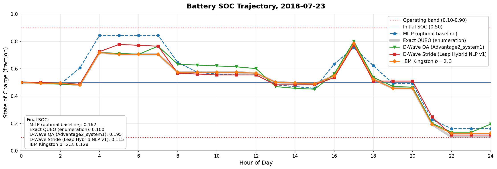

Other results in the paper:

| Result | Value | File |
|---|---|---|
| IBM QAOA above the exact QUBO optimum | 0.05% | `results/paper/solver_totals.csv` |
| Classical samplers on the same QUBO above the exact optimum (SQA, SA, tabu, steepest descent) | 3.1% to 3.7% | `results/paper/solver_totals.csv` |
| Largest gap (low-load day 2018-04-14) | +34% | `results/paper/table2_daily_cost.csv` |
| D-Wave raw samples feasible / windows where repair fired / bits changed | 144/144 / 9 of 144 / 2.4 of 20 | `results/paper/feasibility_repair.csv` |
| Random sampling through the same repair, feasible windows | 58/144 | `results/paper/feasibility_repair.csv` |
| Cost change over k = 1, 3, 5, 10, 51 scenarios | 0.09% | `results/paper/scenarios.csv` |
| Fewer feasible dispatches when balance must hold in every scenario | 18.3% | `results/paper/scenarios.csv` |
| Mean time per window: IBM p = 2 / p = 3 / D-Wave | 332.1 s / 663.5 s / 2.006 s | `results/paper/runtime.csv` |

`results/paper/paper_numbers.csv` lists every number in the paper next to the value computed from
the stored results and the file it comes from.

## Results by date

Study days (`results/paper/study_days.csv`):

| Date | Season | Peak load (MW) | Wind share | Renewable share |
|---|---|---|---|---|
| 2018-03-03 | Winter | 36,970 | 0.366 | 0.371 |
| 2018-04-13 | Spring | 46,795 | 0.466 | 0.470 |
| 2018-04-14 | Spring | 43,805 | 0.512 | 0.518 |
| 2018-06-27 | Summer | 69,075 | 0.189 | 0.195 |
| 2018-07-23 | Summer | 73,111 | 0.109 | 0.113 |
| 2018-10-26 | Fall | 37,906 | 0.014 | 0.020 |

For every date there are three figures in `figures/by_date/<date>/` and five tables in
`results/paper/by_date/<date>/`:

| Date | SOC | Grid import | Hourly cost | Tables |
|---|---|---|---|---|
| 2018-03-03 | [soc](figures/by_date/2018-03-03/soc.png) | [grid](figures/by_date/2018-03-03/grid_import.png) | [cost](figures/by_date/2018-03-03/hourly_cost.png) | [tables](results/paper/by_date/2018-03-03) |
| 2018-04-13 | [soc](figures/by_date/2018-04-13/soc.png) | [grid](figures/by_date/2018-04-13/grid_import.png) | [cost](figures/by_date/2018-04-13/hourly_cost.png) | [tables](results/paper/by_date/2018-04-13) |
| 2018-04-14 | [soc](figures/by_date/2018-04-14/soc.png) | [grid](figures/by_date/2018-04-14/grid_import.png) | [cost](figures/by_date/2018-04-14/hourly_cost.png) | [tables](results/paper/by_date/2018-04-14) |
| 2018-06-27 | [soc](figures/by_date/2018-06-27/soc.png) | [grid](figures/by_date/2018-06-27/grid_import.png) | [cost](figures/by_date/2018-06-27/hourly_cost.png) | [tables](results/paper/by_date/2018-06-27) |
| 2018-07-23 | [soc](figures/by_date/2018-07-23/soc.png) | [grid](figures/by_date/2018-07-23/grid_import.png) | [cost](figures/by_date/2018-07-23/hourly_cost.png) | [tables](results/paper/by_date/2018-07-23) |
| 2018-10-26 | [soc](figures/by_date/2018-10-26/soc.png) | [grid](figures/by_date/2018-10-26/grid_import.png) | [cost](figures/by_date/2018-10-26/hourly_cost.png) | [tables](results/paper/by_date/2018-10-26) |

| Table | Content |
|---|---|
| `summary.csv` | daily cost, gap to MILP and feasible windows for every method, including SQA, SA, tabu, steepest descent and the random control |
| `hourly_cost.csv` | cost of each one-hour window, per method |
| `soc.csv` | SOC at the end of each hour, per method |
| `grid_import_hourly.csv` | mean grid import per hour (fraction of P_G), per method |
| `schedule_15min.csv` | grid import, charge, discharge and SOC for every 15-minute step, per method |

<details>
<summary>SOC trajectories, all six days</summary>

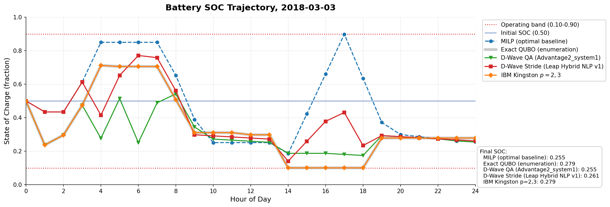
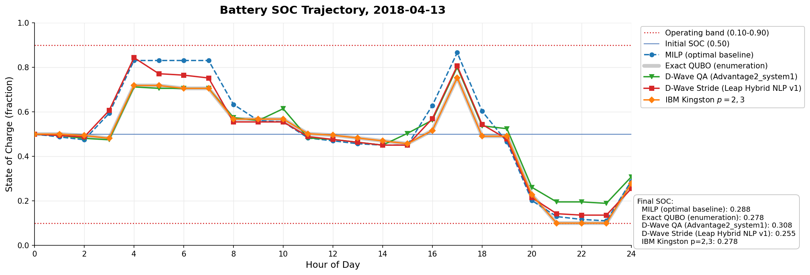
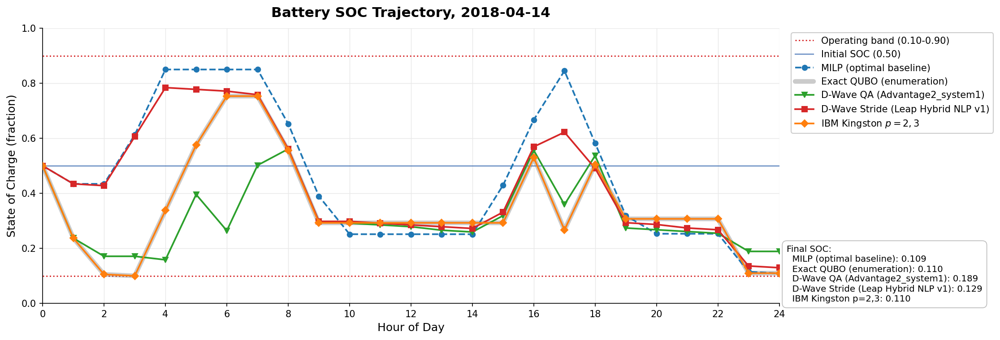
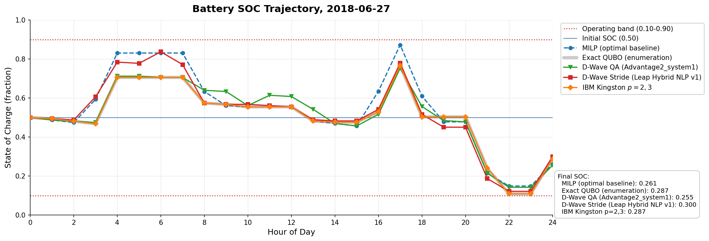
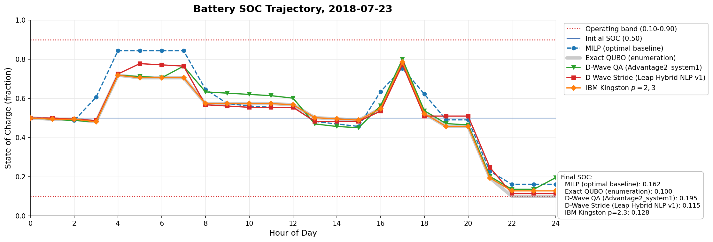
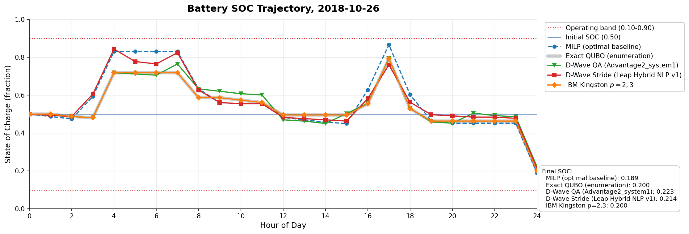

</details>

<details>
<summary>Grid import, all six days</summary>

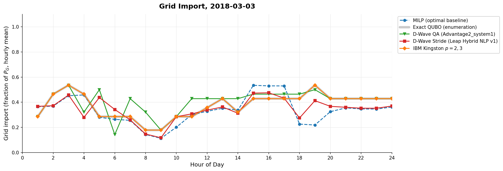
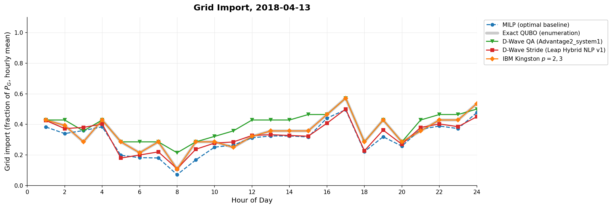
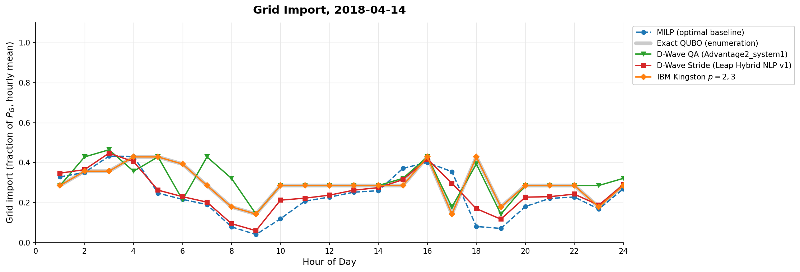
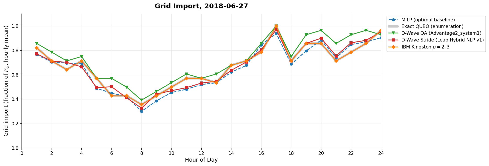
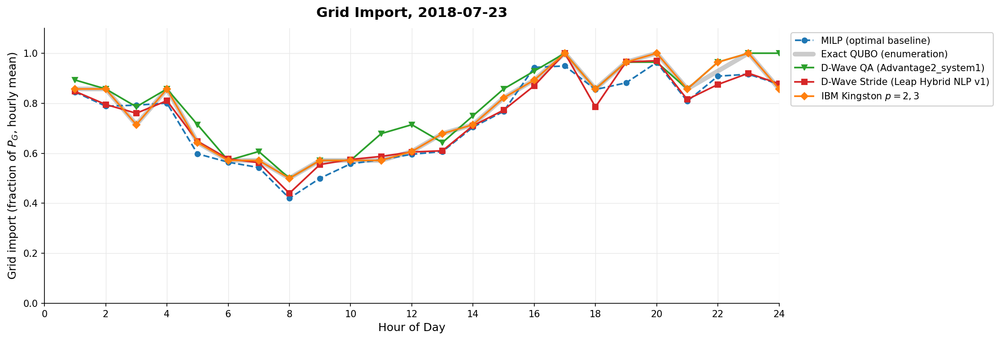
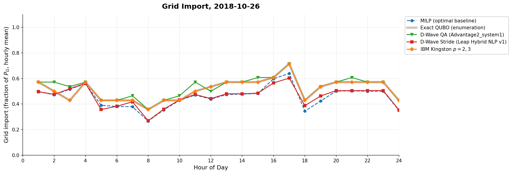

</details>

<details>
<summary>Hourly operating cost, all six days</summary>

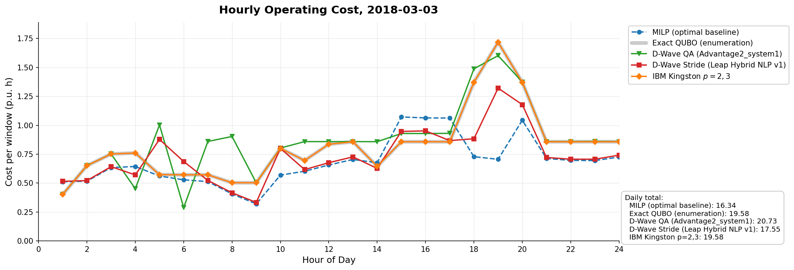
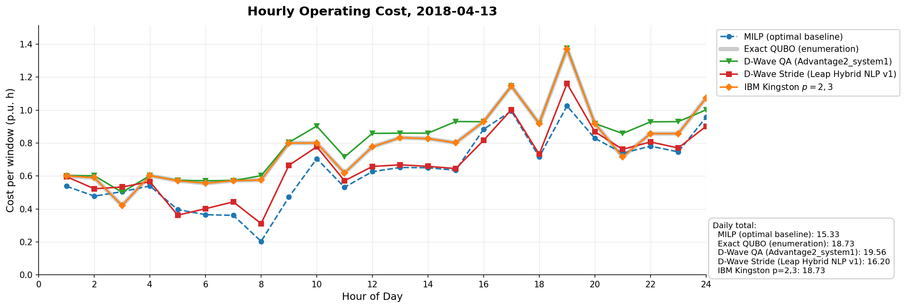
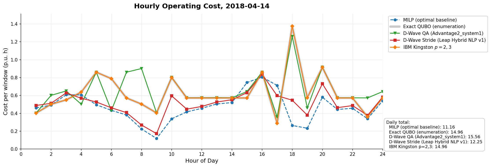
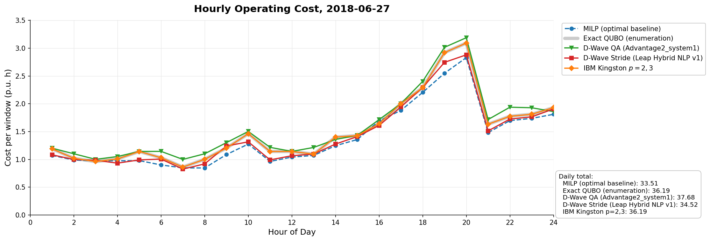
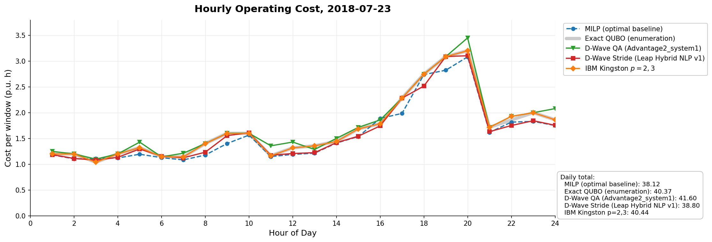
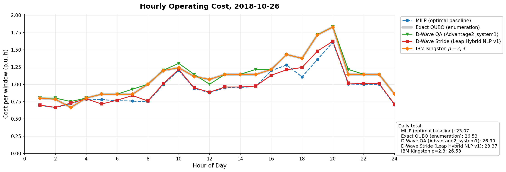

</details>

## QUBO benchmark instances

`results/qubo_instances/` holds the 144 dispatch-window QUBOs of the paper (6 days x 24 windows),
each with 20 binary variables. They are built with the paper's model and settings from the window
inputs of the exact enumeration run. They are small enough to solve exactly and come from real
grid data, so they can serve as a benchmark for quantum annealers, QAOA, and classical heuristics.

Each `results/qubo_instances/<date>/window_<hh>.json` contains:

| Field | Content |
|---|---|
| `n`, `offset`, `linear`, `quadratic` | the QUBO: E(x) = offset + sum_i h_i x_i + sum_{i<j} J_ij x_i x_j |
| `variables` | variable names in index order: `g0_t, g1_t, g2_t` (grid bits), `c_t`, `d_t` for steps t = 0..3 |
| `window` | load, three renewable scenarios with weights, prices (per unit), start SOC, terminal SOC floor, battery mode |
| `reference` | the schedule committed by the exact solver in the paper run (cheapest feasible dispatch of the encoding): assignment, energy and operating cost; the ground-state energy and assignment of the QUBO; the MILP cost of the window |

`results/qubo_instances/index.csv` lists all windows with these reference values. Loading an
instance with D-Wave Ocean:

```python
import json, dimod

inst = json.load(open("results/qubo_instances/2018-07-23/window_17.json"))
bqm = dimod.BinaryQuadraticModel(
    {int(i): v for i, v in inst["linear"].items()},
    {(i, j): v for i, j, v in inst["quadratic"]},
    inst["offset"], dimod.BINARY)
print(bqm.energy(dict(enumerate(inst["reference"]["assignment"]))), inst["reference"]["energy"])
```

`scripts/export_qubo_instances.py` rebuilds the instances from the data and the stored runs. The
reference energy and the ground state (enumeration of all 2^20 assignments) are computed for the
QUBO in each file.

## Repository layout

```
main.py                         rolling-horizon runs: MILP, QAOA (simulator or IBM), SQA, exact QUBO, samplers
notebooks/reproduce_paper.ipynb Colab notebook: tables, figures, per-date results and a QUBO instance
microgrid/                      model, QUBO, solvers, feasibility repair, scheduler; settings in config.py
scripts/
  reproduce_paper.py            all paper tables and figures, and the per-date outputs, from stored results
  export_qubo_instances.py      the 144 window QUBOs as benchmark instances
  run_dwave_qa.py               D-Wave QPU runs
  run_stride_native_rolling.py  D-Wave Stride runs
  grid_aware_soc_clamp.py       grid-aware MILP (MILP column of Table II on 2018-07-23)
  run_milp_only.py              recomputes the rolling MILP and compares it with the stored runs
  scenario_sensitivity.py       scenario-count sweep, k = 1, 3, 5, 10, 51
  scenario_feasibility.py       dispatches feasible under the mean forecast vs. every scenario
data/                           ARPA-E PERFORM ERCOT 2018 load, solar and wind; description in data/README.md
results/
  by_date/<date>/               MILP, exact QUBO, SQA and classical samplers, per window
  by_date/<date>_ibm_kingston_p2|p3/   IBM Kingston QAOA, per window
  dwave_qa/by_date/<date>/      D-Wave QPU, per window
  stride_native/by_date/<date>/ D-Wave Stride, per window
  grid_aware_clamp.csv          grid-aware MILP, per date
  scenario_sensitivity/         scenario-count sweep
  scenario_feasibility/         scenario feasibility counts
  runtime/runtime_by_date.csv   wall-clock time per window, per date (Section IV-C)
  paper/                        tables written by scripts/reproduce_paper.py
  paper/by_date/<date>/         per-date tables
  qubo_instances/               144 window QUBOs with reference solutions
figures/                        Fig. 1 to Fig. 3
figures/by_date/<date>/         per-date SOC, grid import and hourly cost
poster/                         NAPS 2026 poster (PDF and PNG)
.github/workflows/reproduce.yml rebuilds the results and checks every paper number on each push
```

Each per-window folder has `df_compare.csv` (cost and feasibility per window), `df_schedule.csv`
(grid import, battery actions and SOC per 15-minute step) and `df_diagnostics.csv` (raw solver
output, repair and hardware details, including D-Wave problem IDs).

## Installation

Python 3.9.

```
git clone https://github.com/JannatulShorna12/Benchmarking-Quantum-Optimization-for-Microgrid-Energy-Dispatch.git
cd Benchmarking-Quantum-Optimization-for-Microgrid-Energy-Dispatch
python3.9 -m venv .venv
source .venv/bin/activate
pip install -r requirements.txt
```

## Reproduce the tables and figures

```
python scripts/reproduce_paper.py
```

This reads the stored per-window results, so it needs no quantum hardware and no credentials, and it
finishes in a few seconds. The same run happens on GitHub after every push
(`.github/workflows/reproduce.yml`) and fails if any number differs from the paper. The
[Colab notebook](notebooks/reproduce_paper.ipynb) runs it in the browser.

| Paper | Output |
|---|---|
| Table II | `results/paper/table2_daily_cost.csv` |
| Abstract, Section IV-A and conclusion (totals and gaps) | `results/paper/solver_totals.csv` |
| Fig. 2 | `figures/fig2_daily_cost.png` |
| Fig. 3 and final SOC values (Section IV-B) | `figures/fig3_soc_2018-07-23.png`, `results/paper/soc_2018-07-23.csv` |
| Section III-D and IV-B (feasibility and repair) | `results/paper/feasibility_repair.csv` |
| Section III-B (scenarios) | `results/paper/scenarios.csv` |
| Section IV-C (runtime) | `results/paper/runtime.csv` |
| Study days | `results/paper/study_days.csv` |
| Per-date tables and figures | `results/paper/by_date/<date>/`, `figures/by_date/<date>/` |
| D-Wave problem IDs and QPU access time | `results/paper/dwave_problem_ids.csv` |
| Window QUBOs (run `scripts/export_qubo_instances.py`) | `results/qubo_instances/` |

## Run the experiments

Hardware runs need accounts. Copy `apikey.example.json` to `apikey.json` and add an IBM Quantum
token, and copy `dwave_config.example.json` to `dwave_config.json` and add a D-Wave Leap token (or set
`DWAVE_API_TOKEN`). Both files are ignored by git. Quantum hardware samples differ from run to run;
the files under `results/` are the runs reported in the paper.

```
# MILP, exact QUBO, SQA and classical samplers (local)
python main.py --all --no-qaoa --exact --baselines sa tabu greedy random

# QAOA on IBM Kingston, one date at a time, p = 2 and p = 3 (16,384 shots per window by default)
export LAM_REPAIR_HAMMING=0.10 LAM_REPAIR_BALANCE=180
python main.py --date 2018-03-03 --no-sqa --qaoa-p-layers 2 --ibm-backend ibm_kingston
python main.py --date 2018-03-03 --no-sqa --qaoa-p-layers 3 --ibm-backend ibm_kingston
unset LAM_REPAIR_HAMMING LAM_REPAIR_BALANCE

# D-Wave QPU, Advantage2_system1 (dwave_config.json: "qpu": "Advantage2_system1")
python scripts/run_dwave_qa.py --num-reads 1000 --annealing-time-us 20

# D-Wave QPU runtime study, Advantage_system6.4 (dwave_config.json: "qpu": "Advantage_system6.4")
python scripts/run_dwave_qa.py --num-reads 4000 --annealing-time-us 100 --results-dir dwave_qa_system6

# D-Wave Stride, one date at a time
python scripts/run_stride_native_rolling.py --date 2018-03-03

# grid-aware MILP and scenario studies
python scripts/grid_aware_soc_clamp.py
python scripts/scenario_sensitivity.py
python scripts/scenario_feasibility.py

# rebuild the paper tables and figures
python scripts/reproduce_paper.py
```

## Data

`data/` holds the ERCOT 2018 system-level series of the ARPA-E PERFORM datasets (NREL, 2022,
[doi: 10.25984/1891136](https://doi.org/10.25984/1891136), CC BY 4.0). All timestamps are UTC.

| File | Content | Resolution |
|---|---|---|
| `BA_load_actuals_2018.csv` | ERCOT system load | 5 min |
| `BA_solar_actuals_Existing_2018.csv` | solar generation, existing fleet | 5 min |
| `BA_wind_actuals_Existing_2018.csv` | wind generation, existing fleet | 5 min |
| `BA_load_day-ahead_fcst_2018.csv` | day-ahead load forecast, 99 percentiles | hourly |
| `BA_solar_day-ahead_fcst_ecmwf_Existing_2018.csv` | day-ahead solar forecast, 51 ECMWF members | hourly |
| `BA_wind_day-ahead_fcst_ecmwf_Existing_2018.csv` | day-ahead wind forecast, 51 ECMWF members | hourly |

Each study day is resampled to 15-minute steps and divided by P_scale = 73,262.2 MW, the highest hourly
mean load of 2018. The 51 ECMWF members are reduced to three k-means medoid scenarios. See
[data/README.md](data/README.md) for the full description: sources, columns, ranges, the six study
days, every processing step, and how each series enters the dispatch problem.

Please cite the dataset when you use it:

B. Sergi, C. Feng, F. Zhang, B.-M. Hodge, R. Ring-Jarvi, R. Bryce, K. Doubleday, M. Rose, G. Buster
and M. Rossol, "ARPA-E PERFORM datasets," National Renewable Energy Laboratory, 2022,
doi: [10.25984/1891136](https://doi.org/10.25984/1891136).

The data are redistributed under CC BY 4.0 with this attribution. The MIT license of this repository
covers the code.

## Citation

```
@inproceedings{shorna2026benchmarking,
  author    = {Shorna, Jannatul Ferdous and Ni, Zhen and Yang, Zebo and Tang, Yufei and Das, Avijit},
  title     = {Benchmarking Quantum Optimization for Microgrid Energy Dispatch},
  booktitle = {2026 North American Power Symposium (NAPS)},
  year      = {2026}
}
```

Related work from our group on microgrid dispatch under uncertainty:

```
@article{das2022adp,
  author  = {Das, Avijit and Wu, Di and Ni, Zhen},
  title   = {Approximate Dynamic Programming with Policy-Based Exploration for Microgrid Dispatch Under Uncertainties},
  journal = {International Journal of Electrical Power \& Energy Systems},
  volume  = {142},
  pages   = {108359},
  year    = {2022},
  doi     = {10.1016/j.ijepes.2022.108359}
}
```

## Acknowledgment

This work was supported in part by NSF under grants #2047064 and #2320972.

## Contact

Jannatul Ferdous Shorna, jshorna2022@fau.edu

## License

MIT, see [LICENSE](LICENSE).
